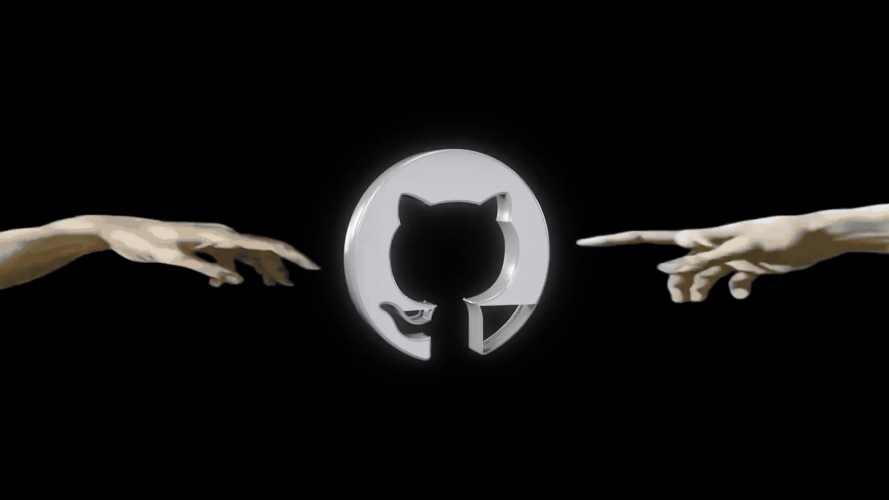

  

  <h1>Backend engineer with a frontend side</h1>

  

    PHP / Laravel&nbsp;&nbsp;·&nbsp;&nbsp;Go / chi&nbsp;&nbsp;·&nbsp;&nbsp;Vue.js&nbsp;&nbsp;·&nbsp;&nbsp;PostgreSQL / MySQL
  

  

    I build web products from the database schema and API contract 
    to the interface people actually use.
  

---

## About

I'm a backend developer based in Chisinau, Moldova. My main stack is **PHP and Laravel**, and I also build services in **Go** with **chi**, **PostgreSQL**, and **MinIO**. When a product needs more than an API, I work across the frontend with **Vue.js** and **Pinia**.

I care about code that stays understandable after the feature ships: clear boundaries, predictable APIs, sensible database design, and infrastructure that does not get in the way.

## Stack

## Experience

### Full-Stack Developer at [Xsort Web Studio](https://xsort.md/en)

`Around six months`

Xsort Web Studio is an international IT company with an office in Moldova, developing websites, online stores, complex web services, and mobile applications. I worked there as a full-stack developer across client web projects.

### Junior Backend Developer at LinkAir

`June 2024 — August 2025`

LinkAir is a travel platform for flights, hotels, tours, and city breaks. I worked on its Laravel backend: built registration and authentication flows, email verification and password recovery, developed profile APIs with Eloquent, and implemented database-driven PDF generation for tickets and invoices.

## Languages

**Russian** — native&nbsp;&nbsp;·&nbsp;&nbsp;**English** — B1&nbsp;&nbsp;·&nbsp;&nbsp;**Romanian** — B1

---

  
<strong>Open to backend and full-stack projects</strong>

  

